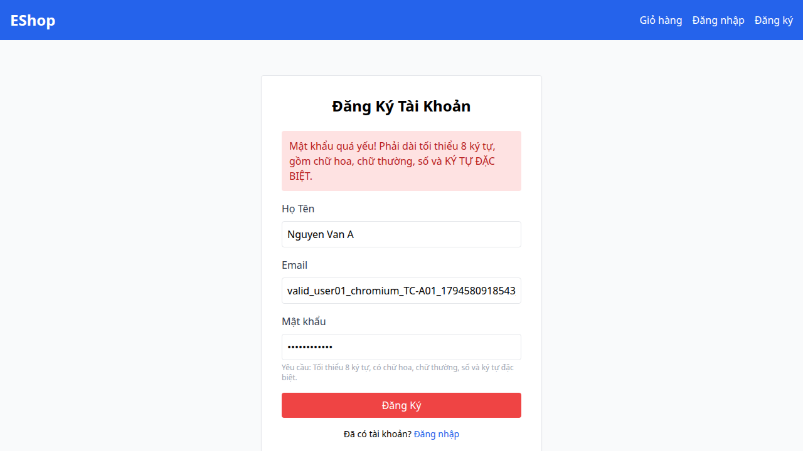
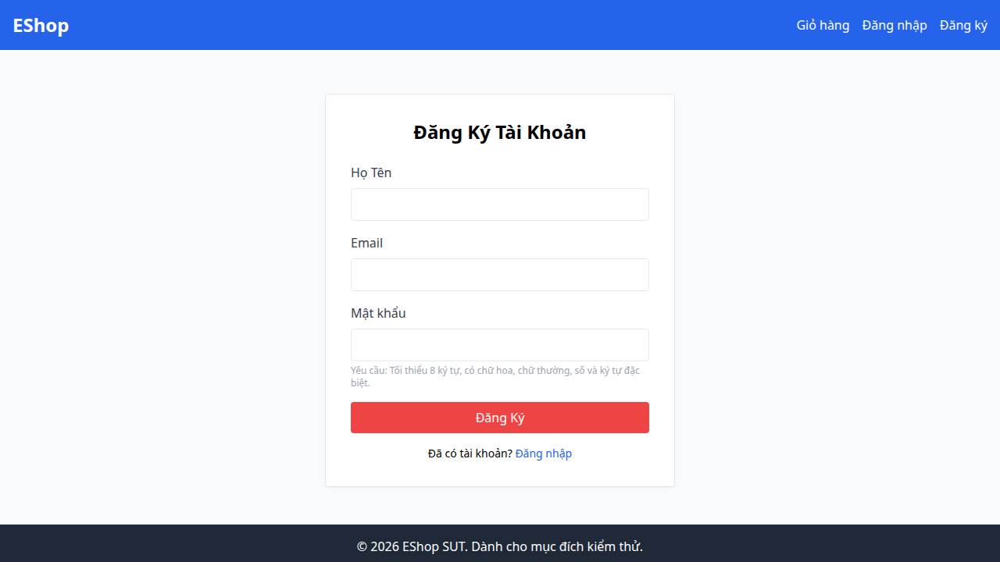
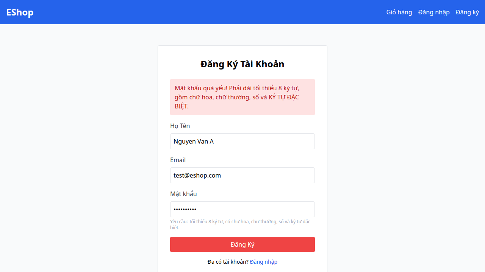
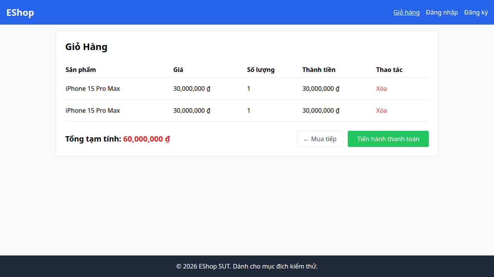
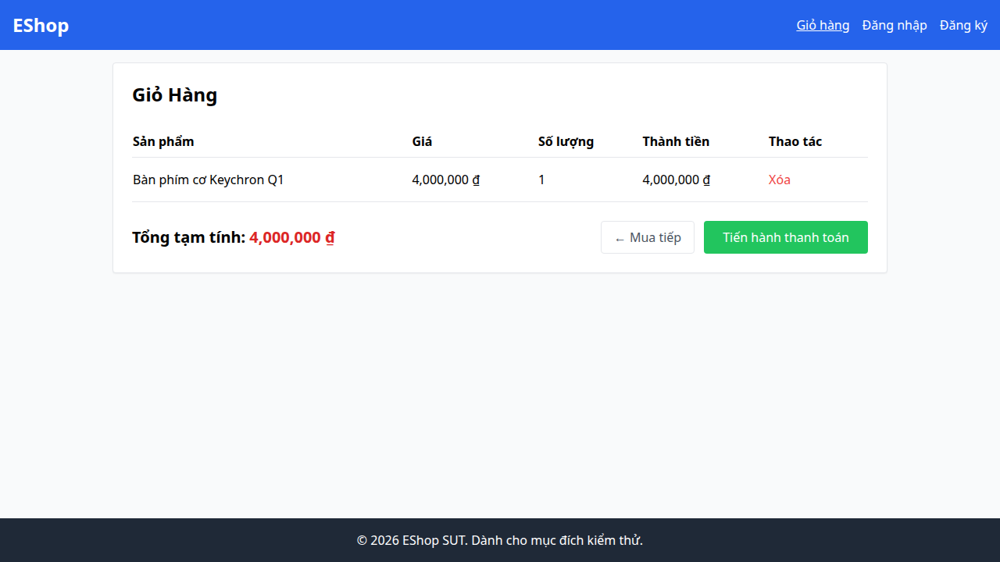
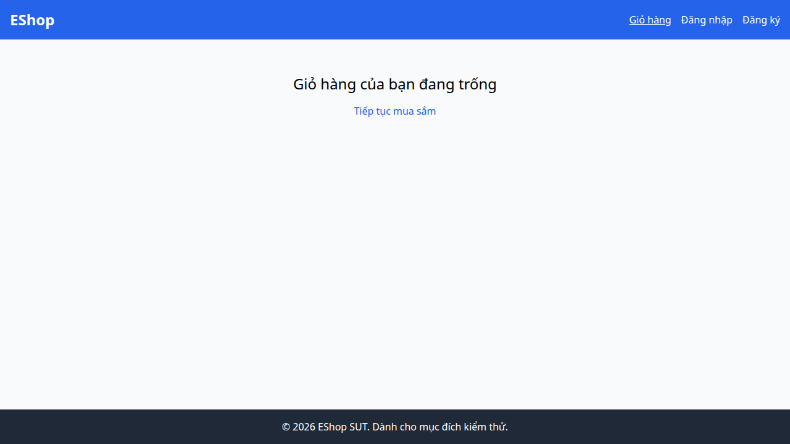
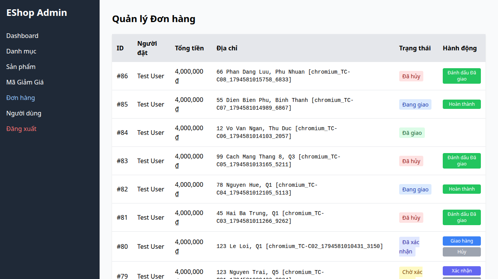
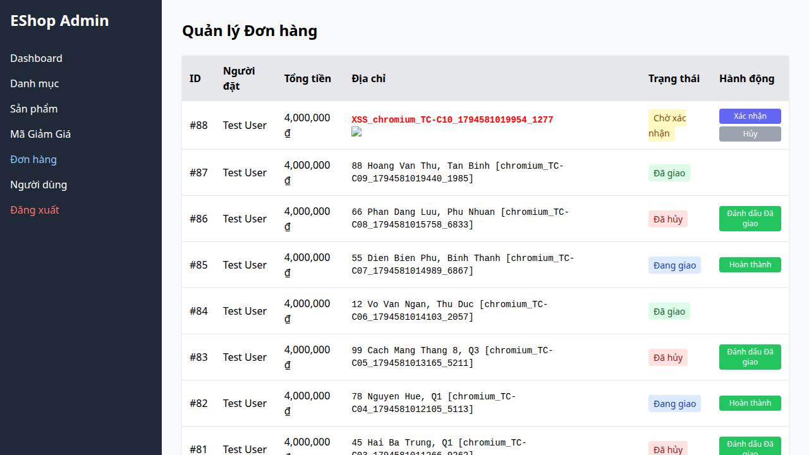
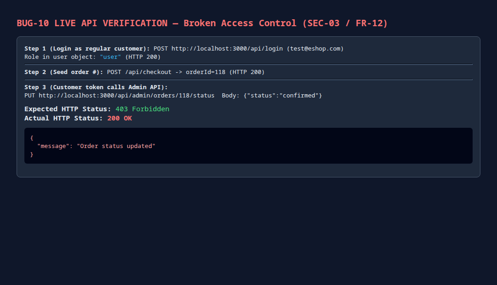

# Bug Report — EShop SUT Automation Discovery (HW04)

- **Student:** Huỳnh Đăng Khoa (`23120285`) — Class `CQ2023/3` (FIT@HCMUS)
- **Target System:** EShop SUT (`backend` `:3000`, `frontend-web` `:5173`, `frontend-admin` `:5174`)
- **Automated Verification Date:** `2026-11-13T14:48:44.739Z`
- **Browsers Verified:** Chromium, Firefox, WebKit (`reports/all-browsers/index.html`)
- **GitHub Issue Automation:** `scripts/create_github_issues.py` — **10 live GitHub Issues posted** (`#1`–`#10`) on public repository [KozKhoa/TestingSoftware-HW04/issues](https://github.com/KozKhoa/TestingSoftware-HW04/issues)

---

## Summary Table of Verified Defects (`BUG-01` – `BUG-10`)

| Bug ID | Feature | Severity | Triggering Automated Test Case(s) | Root Cause in EShop SUT | GitHub Issue & Status |
|---|---|---|---|---|---|
| **BUG-01** | `FR-01` | Critical | `TC-A01`, `TC-A02`, `TC-A03`, `TC-A04`, `TC-A05` | `Register.jsx` `flawedStrongPasswordRegex` requires whitespace (`\s`) and rejects `@$!%*?&` | [#1](https://github.com/KozKhoa/TestingSoftware-HW04/issues/1) (Fail in 3/3 browsers) |
| **BUG-02** | `FR-01` | Major | `TC-A23`, `TC-A24`, `TC-A27` | `Register.jsx` omits mandatory Confirm Password input field | [#2](https://github.com/KozKhoa/TestingSoftware-HW04/issues/2) (Fail in 3/3 browsers) |
| **BUG-03** | `FR-01` / `FR-21,22` | Minor | `TC-A25`, `TC-A26`, `TC-A28` | Labels lack `*`, Email uses `type="text"`, button uses `bg-red-500` instead of `bg-blue-*` | [#3](https://github.com/KozKhoa/TestingSoftware-HW04/issues/3) (Fail in 3/3 browsers) |
| **BUG-04** | `FR-01` / `SEC-01` | Major | `TC-A14`, `TC-A15`, `TC-A17..TC-A22` | Frontend password check masks name/email/duplicate errors; backend stores plaintext passwords & skips uniqueness/email validation | [#4](https://github.com/KozKhoa/TestingSoftware-HW04/issues/4) (Fail in 3/3 browsers) |
| **BUG-05** | `FR-07` | Major | `TC-B03` | `CartContext.jsx` pushes duplicate item row instead of incrementing quantity | [#5](https://github.com/KozKhoa/TestingSoftware-HW04/issues/5) (Fail in 3/3 browsers) |
| **BUG-06** | `FR-07` / `FR-24` | Major | `TC-B02`, `TC-B04..TC-B07`, `TC-B09` | `Cart.jsx` lacks `+`/`-` controls, shows `"Giá"` instead of `"Đơn giá"`, deletes without confirm dialog | [#6](https://github.com/KozKhoa/TestingSoftware-HW04/issues/6) (Fail in 3/3 browsers) |
| **BUG-07** | `FR-07` / `FR-23,24` | Minor | `TC-B01`, `TC-B10`, `TC-B12`, `TC-B13`, `TC-B14` | Wrong labels (`"Tổng tạm tính"`, `"← Mua tiếp"`), missing empty SVG, navbar badge, and breadcrumb | [#7](https://github.com/KozKhoa/TestingSoftware-HW04/issues/7) (Fail in 3/3 browsers) |
| **BUG-08** | `FR-18` / `FR-10` | Major | `TC-C08` | `frontend-admin/src/App.jsx` & `server.js` allow invalid `canceled -> delivered` transition | [#8](https://github.com/KozKhoa/TestingSoftware-HW04/issues/8) (Fail in 3/3 browsers) |
| **BUG-09** | `FR-18` / `SEC-04` | Critical | `TC-C10` | `frontend-admin/src/App.jsx` renders `shipping_address` via `dangerouslySetInnerHTML` (Stored XSS) | [#9](https://github.com/KozKhoa/TestingSoftware-HW04/issues/9) (Fail in 3/3 browsers) |
| **BUG-10** | `FR-18` / `SEC-03` | Critical | `TC-C11` | `backend/server.js` admin order endpoints check JWT auth only and omit `req.user.role === 'admin'` (returns `200` instead of `403`) | [#10](https://github.com/KozKhoa/TestingSoftware-HW04/issues/10) (Fail in 3/3 browsers) |

---

## Detailed Defect Reports & Screenshots

### [BUG-01] Flawed Password Regex Blocks Valid Registration (`Critical`)
- **Spec Reference:** `FR-01` (`tests/fr01-register.spec.ts`: `TC-A01..TC-A05`)
- **Steps to Reproduce:** Open `/register`, enter `Nguyen Van A`, unique valid email, password `ValidP@ss123`, click `Đăng Ký`.
- **Expected Result:** Registration succeeds and redirects to `/login`.
- **Actual Result:** `.bg-red-100` displays *"Mật khẩu quá yếu! Phải dài tối thiểu 8 ký tự, gồm chữ hoa, chữ thường, số và KÝ TỰ ĐẶC BIỆT."* because `Register.jsx` regex enforces `(?=.*\s)` and whitelist `[A-Za-z\d\s]{8,}` instead of `[@$!%*?&]`.

---

### [BUG-02] Missing Confirm Password Field on Registration Form (`Major`)
- **Spec Reference:** `FR-01` (`tests/fr01-register.spec.ts`: `TC-A23`, `TC-A24`, `TC-A27`)
- **Expected Result:** Form includes a `Xác nhận mật khẩu` (`input[type="password"]`) field validating equality with password.
- **Actual Result:** Only 1 password input renders (`locator('form input[type="password"]').nth(1)` is absent).

---

### [BUG-03] Registration UI Compliance Violations (`Minor`)
- **Spec Reference:** `FR-21`, `FR-22` (`tests/fr01-register.spec.ts`: `TC-A25`, `TC-A26`, `TC-A28`)
- **Findings:** Labels omit `*` required markers (`Họ Tên`, `Email`, `Mật khẩu`); Email field uses `type="text"` instead of `type="email"`; Submit button renders `bg-red-500` instead of brand `bg-blue-*`.

---

### [BUG-04] Missing Name/Email/Uniqueness Validation & Plaintext Passwords (`Major`)
- **Spec Reference:** `FR-01`, `SEC-01` (`tests/fr01-register.spec.ts`: `TC-A14..TC-A15`, `TC-A17..TC-A22`)
- **Findings:** Submitting whitespace-only name, 256-char name, malformed emails (`usertesteshop.com`, `@eshop.com`, etc.), or duplicate `test@eshop.com` triggers the broken password error message instead of specific field/duplicate validation errors; backend `server.js` inserts raw passwords into SQLite without hashing.

---

### [BUG-05] Adding Same Product Twice Creates Duplicate Cart Rows (`Major`)
- **Spec Reference:** `FR-07` (`tests/fr07-cart.spec.ts`: `TC-B03`)
- **Steps to Reproduce:** Click `Thêm vào giỏ` twice on `iPhone 15 Pro Max` at `/`, then click `Giỏ hàng` link in header navbar.
- **Expected Result:** `1` table row with quantity `2` and subtotal `60,000,000 ₫`.
- **Actual Result:** `2` separate rows with quantity `1` each because `CartContext.jsx` appends directly to array without checking existing item IDs.

---

### [BUG-06] Missing `+/-` Quantity Controls, Instant Unconfirmed Deletion & Wrong Price Header (`Major`)
- **Spec Reference:** `FR-07`, `FR-24` (`tests/fr07-cart.spec.ts`: `TC-B02`, `TC-B04`, `TC-B05`, `TC-B06`, `TC-B07`, `TC-B09`)
- **Findings:** Table header column 2 renders `"Giá"` instead of `"Đơn giá"`; quantity column shows plain number without `+` / `-` buttons; clicking `"Xóa"` deletes immediately with zero confirmation dialog or cancel option.

---

### [BUG-07] Cart Labels (`Tổng tạm tính`, `← Mua tiếp`), Empty SVG, Navbar Badge & Breadcrumb Defects (`Minor`)
- **Spec Reference:** `FR-07`, `FR-23`, `FR-24` (`tests/fr07-cart.spec.ts`: `TC-B01`, `TC-B10`, `TC-B12`, `TC-B13`, `TC-B14`)
- **Findings:**
  - Total summary renders `"Tổng tạm tính"` instead of `"Tổng cộng"` (`TC-B10`).
  - Back button renders `"← Mua tiếp"` instead of `"Tiếp tục mua sắm"` (`TC-B12`).
  - Empty cart page displays no SVG/image illustration (`TC-B01`, shown below).
  - Header navbar `Giỏ hàng` link shows no quantity badge (`TC-B13`) and `/cart` lacks breadcrumb (`TC-B14`).

---

### [BUG-08] Canceled Order Allows Transition to `delivered` (`Major`)
- **Spec Reference:** `FR-10`, `FR-18` (`tests/fr18-admin-orders.spec.ts`: `TC-C08`)
- **Expected Result:** `canceled` is a terminal state with no status-changing buttons and `PUT /api/admin/orders/:id/status` returning HTTP `400`.
- **Actual Result:** Admin table renders green `"Đánh dấu Đã giao"` button on `"Đã hủy"` rows (e.g. `#86`) and API accepts `delivered` with HTTP `200`.

---

### [BUG-09] Stored XSS via `dangerouslySetInnerHTML` on Shipping Address (`Critical`)
- **Spec Reference:** `FR-18`, `SEC-04` (`tests/fr18-admin-orders.spec.ts`: `TC-C10`)
- **Steps to Reproduce:** Checkout an order containing `<b data-xss-marker="1" style="color:red">XSS_...</b>` and view Admin Orders table (`#88`).
- **Expected Result:** Address renders strictly as escaped plain text (`0` parsed HTML nodes, JS never executes).
- **Actual Result:** `frontend-admin/src/App.jsx` injects raw HTML into DOM via `dangerouslySetInnerHTML`, rendering bold red HTML markup, an `` tag (`2` XSS nodes detected), and executing the `onerror` script (`window.__xssHits[nonce] === true`).

---

### [BUG-10] Missing Admin Role RBAC Check on `/api/admin/orders/:id/status` (`Critical`)
- **Spec Reference:** `FR-12`, `SEC-03` (`tests/fr18-admin-orders.spec.ts`: `TC-C11`)
- **Root Cause:** `backend/server.js` protects `/api/admin/orders` and `/api/admin/orders/:id/status` only with `authenticateToken`, omitting role verification `req.user.role === 'admin'`.
- **Expected Result:** HTTP `403 Forbidden` when regular user (`test@eshop.com`, `role: "user"`) calls `PUT /api/admin/orders/:id/status`.
- **Actual Result:** Returns HTTP `200 OK` with `{"message": "Order status updated"}`.

